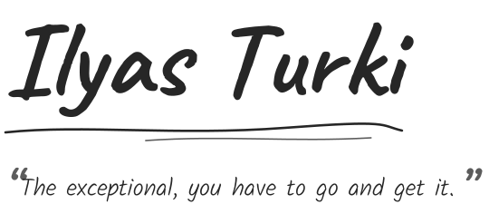

<picture>
  <source media="(prefers-color-scheme: dark)" srcset="assets/header-dark.svg" />
  
</picture>

[ilyasturki.com](https://ilyasturki.com) · [x.com/ilyasturki_](https://x.com/ilyasturki_) · [LinkedIn](https://www.linkedin.com/in/ilyas-turki) · [me@ilyasturki.com](mailto:me@ilyasturki.com)

I do everything myself, from product to customer support. Pinned below is what's public. The rest lives here.

<picture>
  <source media="(prefers-color-scheme: dark)" srcset="assets/closed-doors-dark.svg" />
  
</picture>

- <picture><source media="(prefers-color-scheme: dark)" srcset="assets/icon-aplorio-dark.svg" /></picture> **[Aplorio](https://aplorio.fr)** · quotes and invoices for French building trades, dictated on site from the phone
- <picture><source media="(prefers-color-scheme: dark)" srcset="assets/icon-site-dark.svg" /></picture> **[ilyasturki.com](https://ilyasturki.com)** · my site, in French and English, drawn in pencil and built with Nix

<picture>
  <source media="(prefers-color-scheme: dark)" srcset="assets/machines-dark.svg" />
  
</picture>

<picture><source media="(prefers-color-scheme: dark)" srcset="assets/icon-nix-config-dark.svg" /></picture> **nix-config** 
One flake runs a Ryzen 9 desktop, an XPS 13 and an N100 home server, joined by Tailscale. GNOME and home-manager on top, secrets in sops-nix, Restic backups, Syncthing for what Nix shouldn't own. The home server runs Jellyfin, Immich, Komga and AdGuard.

<picture><source media="(prefers-color-scheme: dark)" srcset="assets/icon-infra-apps-dark.svg" /></picture> **infra-apps** 
A single NixOS VPS hosts every app I run in production. It was installed with nixos-anywhere, and a Playwright suite checks the live sites every day and after each deploy.

<picture>
  <source media="(prefers-color-scheme: dark)" srcset="assets/how-i-work-dark.svg" />
  
</picture>

- Agents write most of my code. Two skills took me from 24 to 94 commits a day. One commits each change on its own, the other runs agents in parallel.
- I live in the terminal, with Neovim, fish, Claude Code and Codex, and I write my prompts there too.
- Whatever I run is declared in Nix, and self-hosted when I can.

<picture>
  <source media="(prefers-color-scheme: dark)" srcset="assets/journal-dark.svg" />
  
</picture>

<!-- journal:start -->
- Oct 26 · [J'ai lâché le cold call pour le cold email](https://ilyasturki.com/fr/ecrits/cold-email/)
- Oct 25 · [Je suis passé à 100 commits par jour](https://ilyasturki.com/fr/ecrits/cent-commits/)
- Oct 25 · [J'ai testé tous les launchers Linux, alors j'ai fait le mien](https://ilyasturki.com/fr/ecrits/universe/)
- Aug 18 · [Pourquoi j'écris mes prompts dans le terminal](https://ilyasturki.com/fr/ecrits/prompts-terminal/)
<!-- journal:end -->
